# demoscene

**Old-school demoscene intros written in modern C++ on a Mac, plus notes on how to learn this art form today with a fast computer and an AI pair-programmer.**

Every program here is tiny and self-contained. None of them load an image, font, sample or music file. Every pixel and every note is computed while the program runs, which has been the demoscene's core idea since the 1980s.

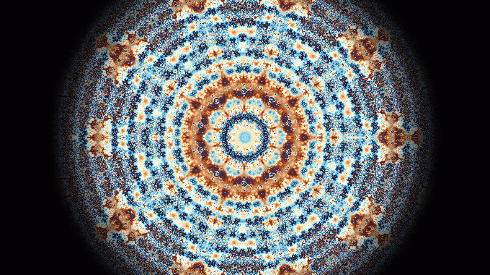

---

## Contents

- [What is the demoscene?](#what-is-the-demoscene)
- [Gallery](#gallery)
- [The examples, one by one](#the-examples-one-by-one)
- [Shared architecture](#shared-architecture)
- [Building and running](#building-and-running)
- [Learning the demoscene today](#learning-the-demoscene-today)
- [Learning with AI (without fooling yourself)](#learning-with-ai-without-fooling-yourself)
- [Suggested exercises](#suggested-exercises)
- [Resources](#resources)
- [Taking your own screenshots](#taking-your-own-screenshots)

---

## What is the demoscene?

The demoscene is a computer art subculture that began in the 1980s on the Commodore 64, Amiga, Atari ST and MS-DOS PCs. Its first form was the **cracktro**: a short intro that cracking groups put in front of software they distributed, with a scrolling message, a logo and a chiptune. Over time the intros became the point. Groups started making them as standalone works and competing at events called **demoparties** (Assembly, The Party, Breakpoint, and today Revision, Evoke, Outline and many others).

The scene judges technique within limits. A *4k intro* has to fit everything, code and music included, in 4096 bytes. A *64k* gets 65536. Classic effects like plasma, copper bars, sine scrollers, rotozoomers and tunnels were famous because they faked expensive-looking images with cheap math on machines with 7 MHz CPUs and a few hundred KB of RAM.

> In this repo, "cracktro" means the **art form only**: logos, scrollers, plasma and chiptunes. Nothing here has anything to do with cracking software or DRM.

---

## Gallery

| | |
|---|---|
| 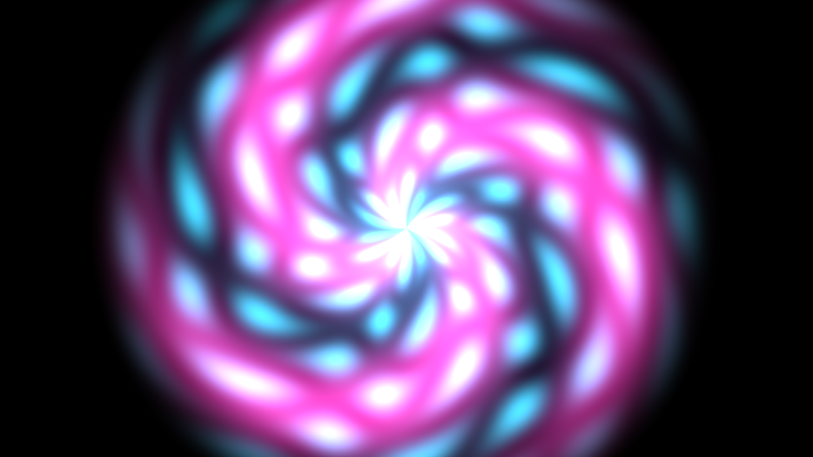 **mac_demo**: shader tunnel |  **psychedelic_zoom_intro**: kaleidoscope fractal |
| 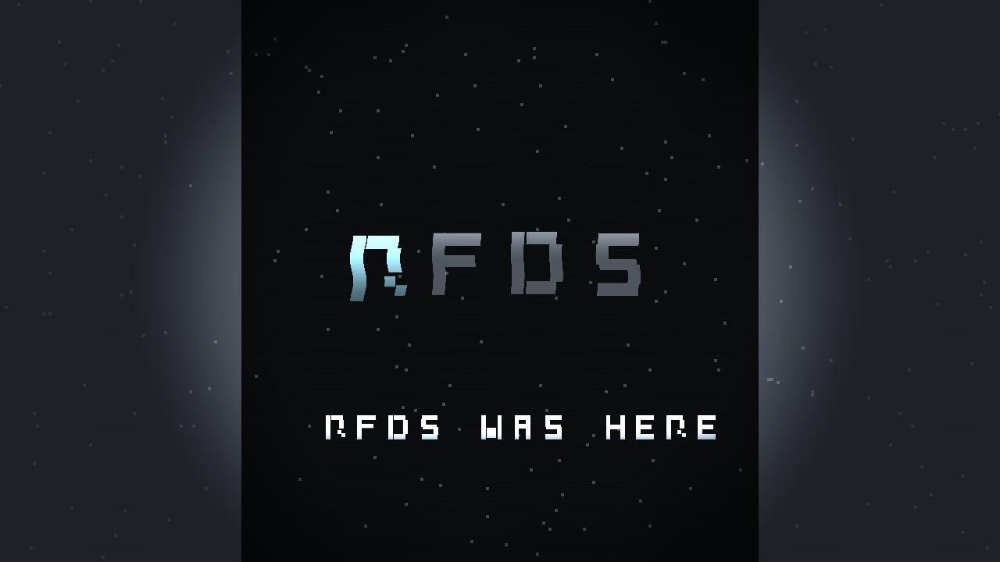 **razor_rfds_intro**: SDF vector logo | 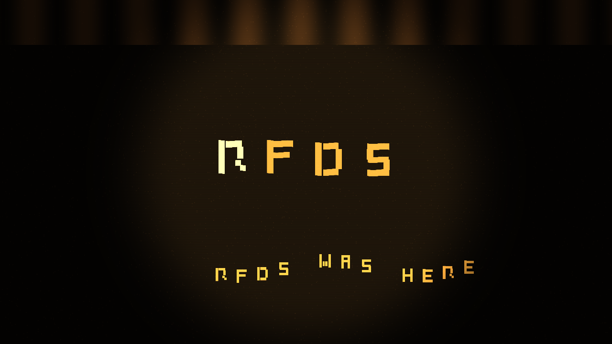 **rfds_amber_crt_intro**: amber CRT and sine scroller |
| 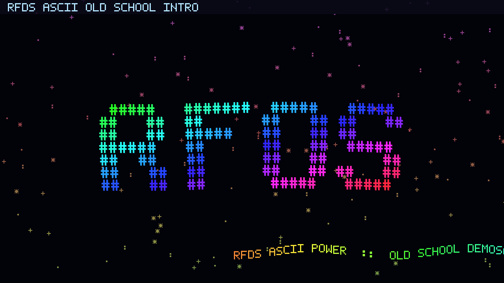 **rfds_ascii_oldschool_intro**: rainbow ASCII | 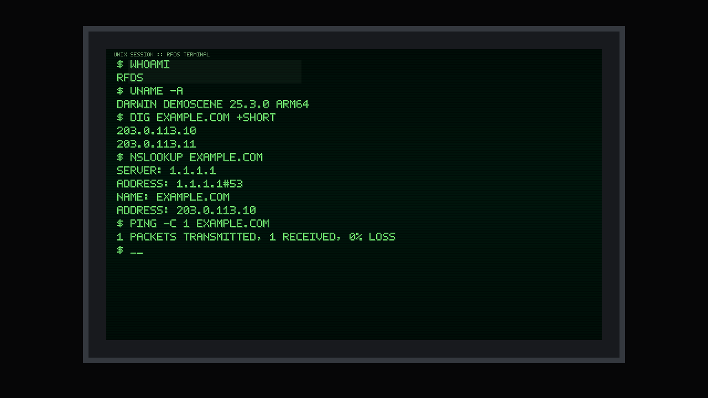 **crt_unix_session_intro**: typed terminal |
| 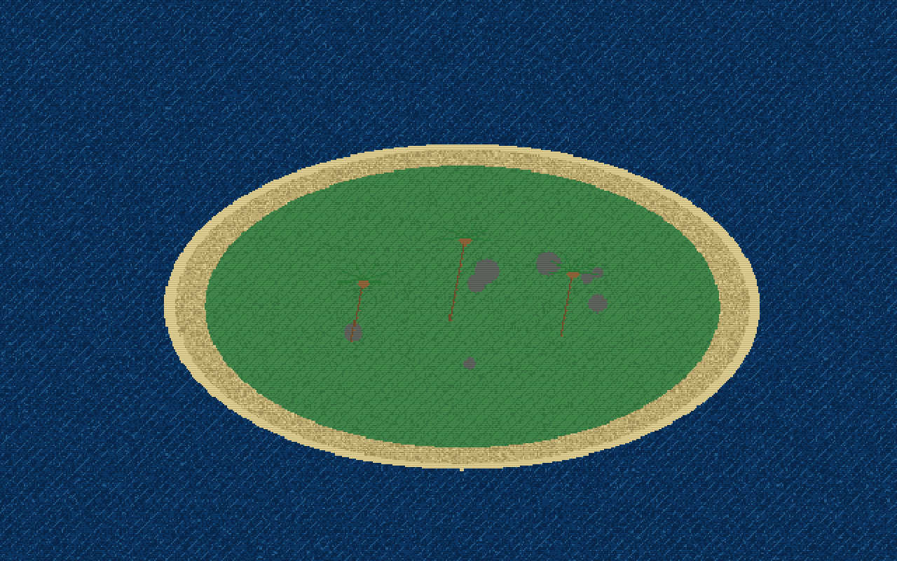 **pcx_island_zoom_intro**: indexed-colour island | 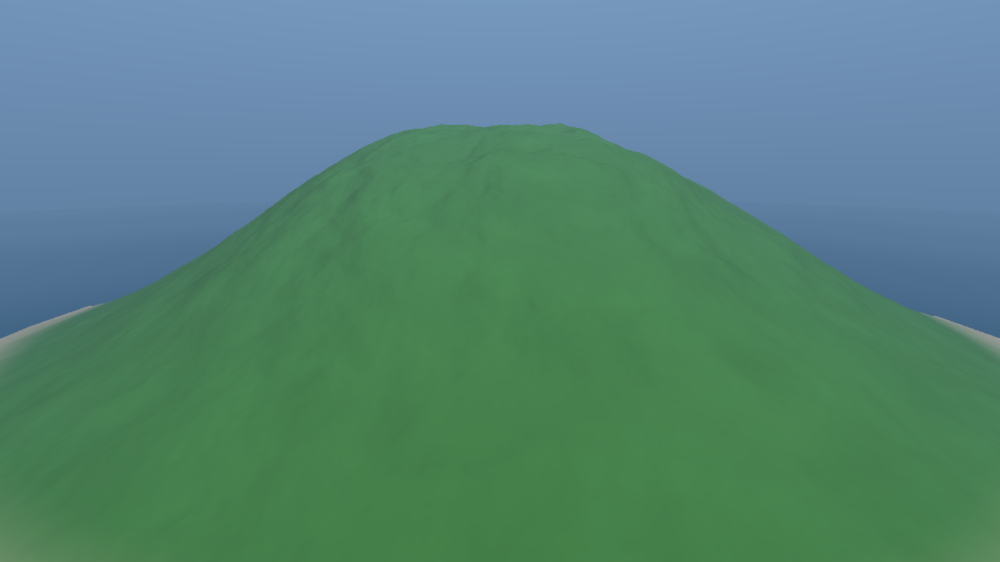 **realism_island_intro**: raymarched terrain |
| 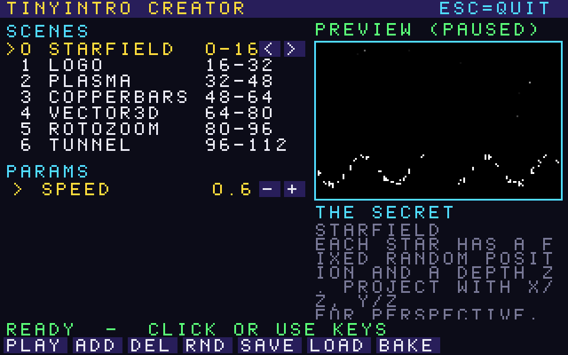 **introcreator** (TinyIntro): cracktro creator | 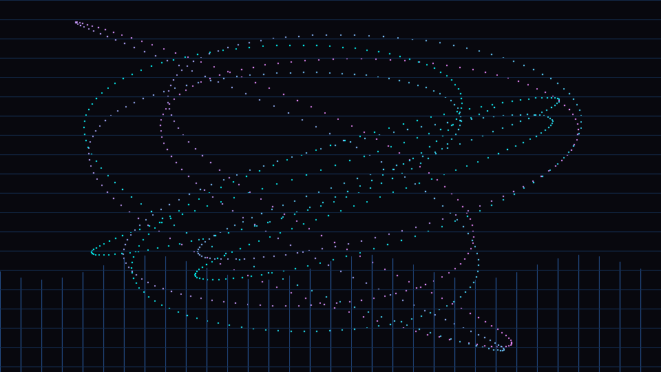 **1.py**: the Python sketch |

---

## The examples, one by one

The examples are ordered roughly from "easiest to read" to "most ambitious". Each section lists what the intro does, the techniques inside it, and what you'll learn by studying it.

### 1. `rfds_ascii_oldschool_intro`: rainbow ASCII and a starfield


A big `RFDS` logo made of `#` characters floats and waves in shifting rainbow colours, over a falling ASCII starfield, with a sine scroller greeting "PARTY PEOPLE!" at the bottom.

- **Rendering:** CPU only, through `SDL_Renderer`. Every character comes from a hand-made **5×7 bitmap font** stored as rows of hex (`'R' → {0x1E, 0x11, 0x11, 0x1E, 0x14, 0x12, 0x11}`), and each lit bit is drawn as a filled rectangle.
- **Motion:** each logo character gets its own `sin`/`cos` offset driven by time, row and column. A faint copy drawn 1px offset fakes phosphor glow.
- **Colour:** a small `Hsv()` helper turns hue into RGB, so the rainbow cycling is just `hue = t*0.08 + row*0.05 + col*0.012`.
- **Audio:** a 132 BPM chiptune loop with a kick on every 8th note, a `tanh`-saturated saw bass and a 16-note **square-wave arpeggio**.
- **Study it for:** bitmap fonts, sine scrollers, palette-free colour animation and the basic SDL audio callback.

### 2. `crt_unix_session_intro`: a typed terminal on a CRT


A fake retro monitor (body, bezel, green-phosphor screen) on which someone types a UNIX session: `whoami`, `uname -a`, `dig`, `nslookup` and `ping`.

- **Human typing:** each script line has a start time and a characters-per-second speed. Spaces, punctuation and every 19th character add small "thinking" pauses.
- **Typos on purpose:** the script contains `\b` backspace characters (`DIG EXAMLPE\b\b\bPLE.COM`). They are applied while the line is shown, so you watch the mistake get fixed.
- **CRT look:** scanlines every 3px, a vertical brightness gradient, a ghost copy of the text for persistence and a translucent glare rectangle.
- **Audio:** calm, wintry ambient at 84 BPM, with a root/fifth/octave sine pad, a soft sub bass, bell-like chimes and a little breathy noise.
- **Study it for:** timeline-driven storytelling, which is how "demo direction" works: events placed on a clock.

### 3. `pcx_island_zoom_intro`: a 90s PCX-style island


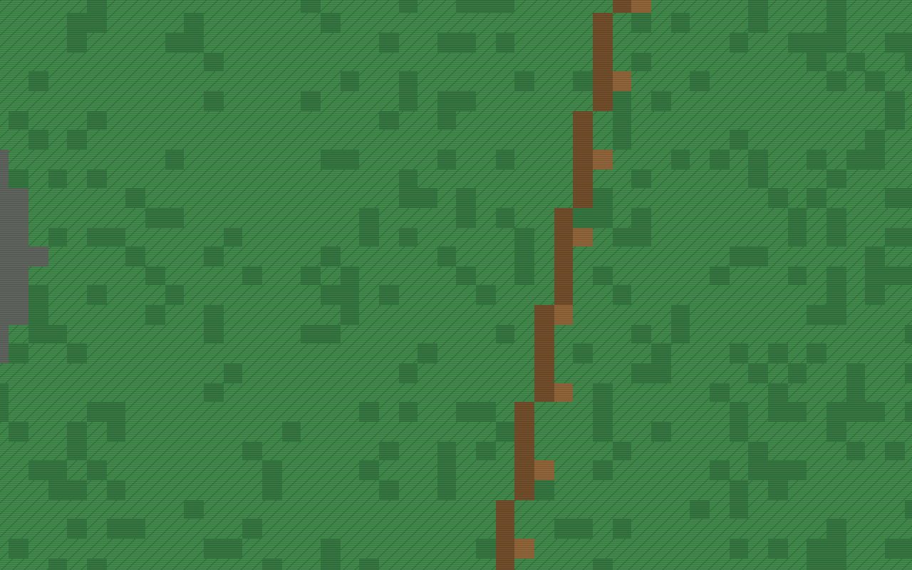

A low-res, indexed-colour tropical island with palm trees, and an endless zoom into one palm. At 30× magnification it cuts to a second island and starts again. The second image shows the zoom deep enough that you see the chunky pixels.

- **Software renderer:** the map is a `std::vector<uint8_t>` of **palette indices**, not colours. Each frame is converted to RGBA through a 16-colour palette and uploaded to an `SDL_Texture`.
- **Procedural art:** an ellipse decides the grass/sand/shore bands, an integer hash adds dithered water and noisy shading, and rocks are filled circles.
- **Classic algorithms:** palm trees use a hand-written **Bresenham line** routine. The zoom is nearest-neighbour sampling (`SDL_HINT_RENDER_SCALE_QUALITY "0"`).
- **Resolution:** laid out in 320×200 (VGA mode 13h) coordinates and rendered at 640×400.
- **Study it for:** framebuffers, palettes, dithering, and drawing everything yourself. This one has no audio.

### 4. `mac_demo`: the first shader intro


A two-scene intro and the template for every shader intro after it. Press `1` for the colourful tunnel above, and `2` for a monochrome, Revision-party-style scene with a scrolling "code" panel, a crowned emblem and a HUD.

- **Rendering:** a single GLSL 1.20 fragment shader draws everything. The CPU only draws one fullscreen quad and passes `iResolution`, `iTime`, `iBeat` and `iScene` as uniforms (Shadertoy naming, so the code ports easily).
- **Tunnel:** polar coordinates (`atan`, `length`) feed `sin` rings and spirals, plus value noise and a centre glow that pulses on the beat.
- **Scene 2:** shapes are built from **signed distance functions** (`sdBox`) and hashed pseudo-glyphs.
- **Audio:** 138 BPM, with a pitch-swept sine kick, a sine bass, a cubed-sine lead and noise hi-hats, soft-clipped with `tanh`.
- **Study it for:** the minimal "SDL2 + OpenGL + fragment shader + synth" skeleton that every later intro copies.

### 5. `psychedelic_zoom_intro`: kaleidoscope and fractal warp


A nonstop, very colourful zoom that folds space into a kaleidoscope and flashes a strobe at the end of each zoom cycle.

- **Infinite zoom:** `uv /= pow(2.0, fract(t*0.16)*8.0)` zooms 8 octaves and snaps back. The pattern is self-similar, so you never see the jump.
- **Kaleidoscope:** polar folding, `abs(mod(angle, 2π/N) - π/N)`, where the sector count `N` itself drifts on a sine.
- **Fractal:** 26 iterations of `z = abs(z)/dot(z,z) - 0.83` (the "Kaliset" formula) collect glow and band values.
- **Colour:** Inigo Quilez's cosine palette, `a + b*cos(2π(c*t + d))`, gives a whole rainbow in one line.
- **Audio:** a 138 BPM saw bass, a phase-modulated lead and **sidechain ducking**, where the kick envelope pushes the other instruments down.
- **Study it for:** domain warping and folding, iterated functions and procedural palettes.

### 6. `razor_rfds_intro`: a vector cracktro logo build


A grey/cyan cracktro tribute. The `R → F → D → S` logo builds one letter per beat, with a blinking `RFDS WAS HERE` underneath and side bars framing the screen.

- **Fonts from math:** each letter is a few **SDF rectangles** (`stroke()` around `sdBox`), so the font stays sharp at any resolution and takes no texture memory.
- **Build animation:** a `smoothstep` sweep paints the active letter from bottom to top, driven by `iStepPhase` (the position inside the current beat).
- **Sync:** the *audio thread* decides which letter is active and publishes it through `std::atomic<int>`, so picture and sound can't drift apart.
- **Audio:** 142 BPM techno, with a kick, noise snares on 2 and 4, a saw bass, a square lead and a sine blip **pitched differently for each letter** (C, E, G, B).
- **Study it for:** music-driven animation and SDF typography.

### 7. `rfds_amber_crt_intro`: amber monitor with a funk groove


The RFDS logo again, now on an amber phosphor CRT with a sine scroller and raster bars at the top.

- **Visuals:** the same SDF glyph alphabet (R, F, D, S, W, A, H, E), with the active letter swelling on each quarter note. Scanlines, barrel vignette, static noise and raster-style bars sell the CRT.
- **Sequencer:** the most musical code in the repo, a **16-step pattern sequencer** with a syncopated kick, snare/clap on steps 5 and 13, and **swing** on the odd 16ths.
- **Sound design:** a bass that **glides** between notes (portamento) and mixes a sine sub with a square, plus hi-hats made crisper by differentiating white noise, a one-line high-pass filter.
- **Sync:** each beat fires a chord stab that matches the active letter. A sidechain duck keeps it all pumping at 125 BPM.
- **Study it for:** step sequencers, swing, envelopes and cheap filters.

### 8. `realism_island_intro`: a raymarched island


The opposite of the PCX island: a semi-realistic island seen by a slow, orbiting camera, with sky, sun, animated water and fog.

- **Terrain:** a heightfield made of a Gaussian bump plus **fBm** (5 octaves of value noise), **raymarched** in up to 120 adaptive steps inside the fragment shader.
- **Shading:** finite-difference normals, sand to grass by height, to rock by slope, fake ambient occlusion and specular glints at the shoreline.
- **Water:** a ray–plane intersection with sine-wave normals, **Fresnel** sky reflection and a sharp sun highlight.
- **Atmosphere:** exponential distance fog and a look-at camera (`ro`, `ta`, `uu/vv/ww`) that orbits and zooms gently.
- **Audio:** a slow 78 BPM ambient bed, with a three-oscillator pad, a 49 Hz drone and chimes on every beat.
- **Study it for:** the modern demoscene toolkit of raymarching, noise, lighting and fog, all in one shader.

### 9. `introcreator/` (TinyIntro): a cracktro creator


| Plasma | Tunnel | Vector 3D |
|---|---|---|
| 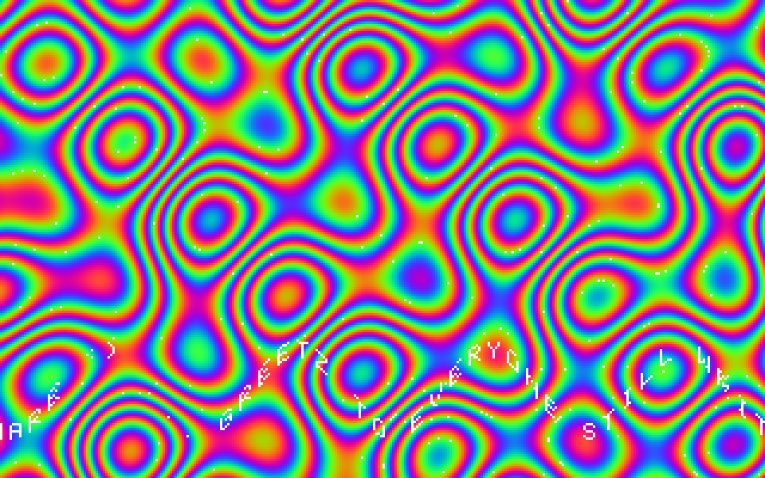 | 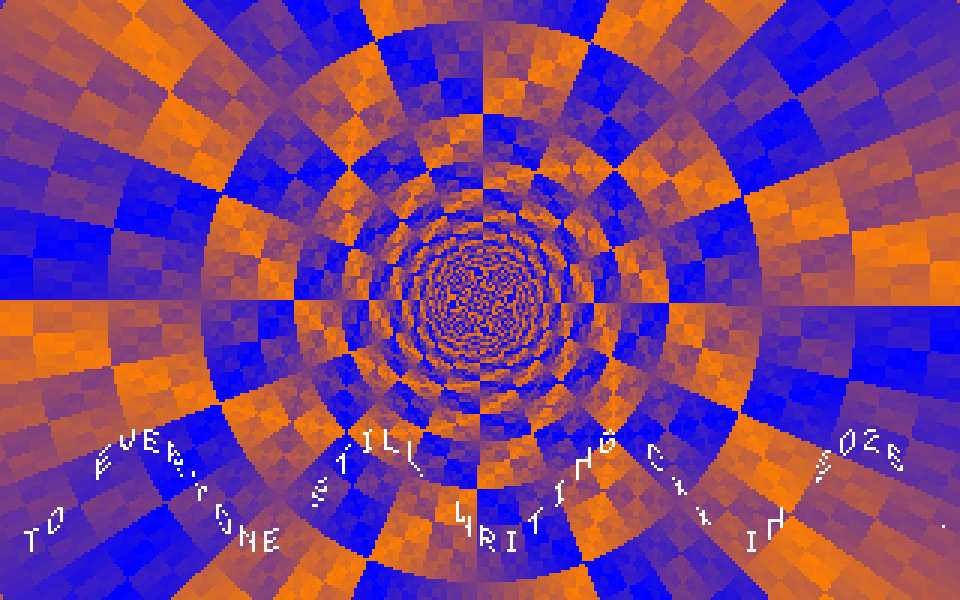 | 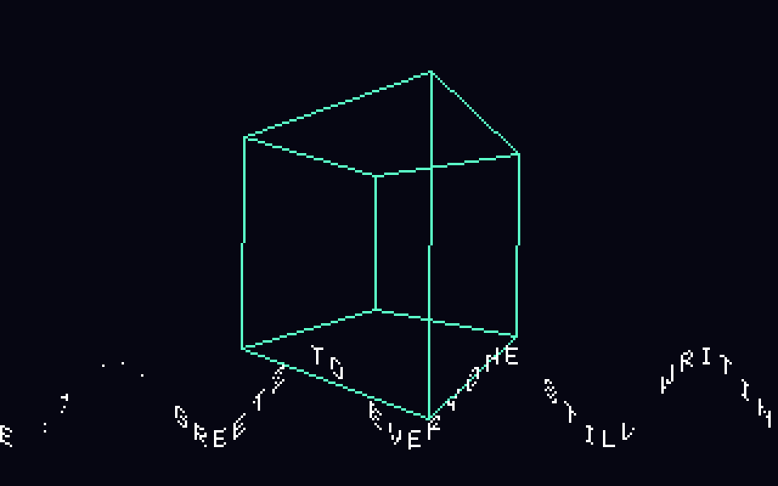 |
| **Logo** | **Copper bars** | |
| 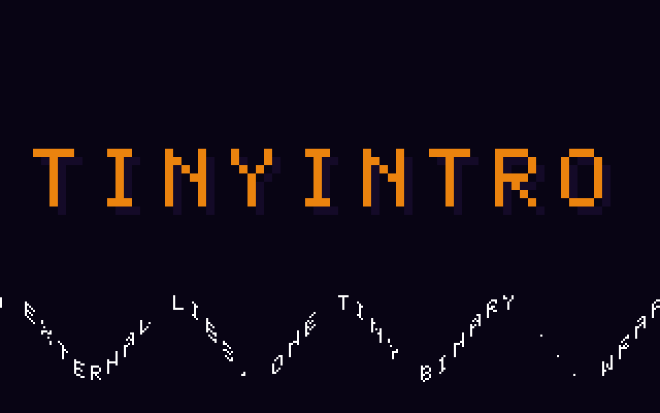 | 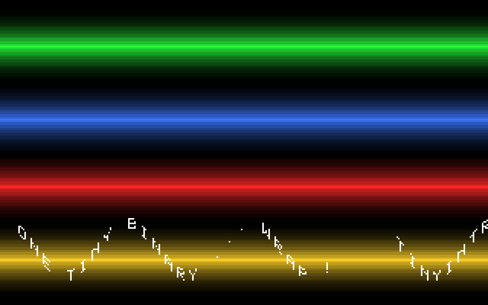 | |

The largest project here. It's a macOS app where you build a multi-scene cracktro in a retro pixel GUI, preview it live, read "the secret" behind each effect, and **bake** it into a standalone native binary. See [`introcreator/README.md`](introcreator/README.md) for the full manual.

- **Zero dependencies:** windowing is pure **Cocoa** and audio is **CoreAudio** (Objective-C++ `.mm` files). No SDL, no Homebrew.
- **Engine:** an authentic **CPU software renderer**, with 320×200 8-bit indexed colour, fixed-point **sine tables**, a pixel font, a timeline and an effect registry.
- **Eight effects**, each one commented `.cpp`: plasma (palette cycling), copper bars, sine scroller, starfield, rotozoom, tunnel (precomputed angle/depth tables), wireframe vector 3D and a giant logo.
- **Data-driven:** intros are plain-text `.tro` files (`bpm 125`, `scroll ...`, `scene plasma 16 16 ...`). Baking compiles **only the chosen effects** into a ~68 KB binary.
- **Audio as the clock:** the chiptune's sample position is the master clock, so visuals stay locked to the beat.
- **Study it for:** turning one-off intros into an engine, plus table-driven, integer-only graphics the way it was done on a 486.

### 10. `1.py`: the Python sketch where it started


A 72-line pygame warm-up: 900 points tracing Lissajous-style curves over a rippling wireframe grid, with a little synth melody.

- **Synth:** notes are built up front with Python's `array` module, a sine plus its 2nd harmonic with an exponential decay, packed into 16-bit `pygame.mixer.Sound` buffers.
- **Sequencer:** an 8-note scale played as 8th notes at 140 BPM.
- **The lesson:** it syncs to wall-clock time (`time.time()`). The C++ versions moved the clock into the audio callback, and that change is the biggest difference between "a sketch" and "a demo".

---

## Shared architecture

Except for TinyIntro and `1.py`, all intros share one skeleton in a single `src/main.cpp`:

```
                 ┌──────────────────────────────┐
                 │  SDL audio callback (48 kHz) │
                 │  oscillators → envelopes →   │
                 │  sequencer → tanh soft clip  │
                 └──────────────┬───────────────┘
                                │ std::atomic<float> beatPulse
                                │ std::atomic<int>   step / letter
                                ▼
┌────────────┐      ┌──────────────────────────────┐
│ SDL2 input │ ───▶ │          main loop           │
│ Esc / F    │      │ time, beat → uniforms or CPU │
└────────────┘      └──────────────┬───────────────┘
                                   │
                ┌──────────────────┴──────────────────┐
                ▼                                     ▼
   OpenGL 2.1 fullscreen quad              SDL_Renderer / streaming
   + GLSL 1.20 fragment shader             texture (CPU pixels)
   (mac_demo, psychedelic, razor,          (ascii, crt_unix, pcx)
    amber, realism)
```

Patterns you'll see everywhere:

- **Audio drives visuals.** The audio thread knows exactly when the beat lands. It stores `1.0` into an atomic, and the render loop reads it and decays it (`beat *= 0.93`) to get a flash.
- **`tanh` as a mastering chain.** Every synth ends with `std::tanh(sample * ~1.2)`, a soft clipper that glues the mix and prevents harsh digital clipping.
- **Phase accumulators.** Oscillators add `2π·f·dt` each sample and wrap, instead of computing `sin(2π·f·t)` directly. That keeps pitch changes click-free.
- **Shadertoy-style uniforms** (`iTime`, `iResolution`, `iBeat`), so shader code moves between this repo and [shadertoy.com](https://www.shadertoy.com) with almost no changes.

---

## Building and running

### Requirements

- macOS (Apple Silicon or Intel) with the Xcode Command Line Tools: `xcode-select --install`
- [Homebrew](https://brew.sh) packages for the SDL intros: `brew install cmake sdl2`

The SDL intros use legacy OpenGL 2.1, which macOS still ships, though it's deprecated. They should also build on Linux with small `#include` changes (`<GL/gl.h>` instead of `<OpenGL/gl.h>`).

### SDL2 intros

```bash
cd razor_rfds_intro          # or any *_intro folder, or mac_demo
cmake -S . -B build
cmake --build build -j
./build/razor_rfds_intro
```

Controls: `Esc` quits and `F` toggles fullscreen. `mac_demo` also uses `1`/`2` to switch scenes.

### TinyIntro

```bash
cd introcreator
bash build/build.sh          # builds build/out/tinyintro and build/out/tinyintro-demo
./build/out/tinyintro        # the creator panel
./build/out/tinyintro-demo   # a ready-made multi-scene intro
```

### The Python sketch

```bash
python3 -m venv .venv && source .venv/bin/activate
pip install pygame-ce        # or: pip install pygame
python 1.py
```

---

## Learning the demoscene today

### Then and now

| 1992 | Today |
|---|---|
| 7–33 MHz CPU, no GPU | Many cores plus a GPU with thousands of shader cores |
| Assembly, because nothing else was fast enough | C, C++, Rust, Zig, GLSL, Metal, WGSL… and assembly when you *want* the challenge |
| Tricks learned from disk magazines, BBSes and disassembling other demos | Open source, Shadertoy, YouTube breakdowns, papers, and AI that explains code line by line |
| 256 colours, a palette and a 320×200 framebuffer | Limits you choose yourself: a 4k exe, a 256-byte intro, a fantasy console, a single shader |

The limits are now **self-imposed**, and they are the useful part. A modern Mac can brute-force almost anything, so the craft is in choosing constraints and being clever inside them. That's why the 4k and 64k categories, the 256-byte intros and fantasy consoles like PICO-8 and TIC-80 are all thriving.

### A learning path that works

1. **Start with a framebuffer.** Open a window, get a pixel array, put pixels in it. Draw a gradient, then a moving gradient. (See `pcx_island_zoom_intro`.)
2. **Learn the classic effects on the CPU,** in roughly this order: starfield, sine scroller, plasma with palette cycling, copper bars, rotozoom, tunnel, wireframe 3D. Each one teaches one idea: projection, lookup tables, palettes, per-scanline tricks, texture-space stepping, precomputed tables, matrices. (See `introcreator/effects/`. Each file explains its own trick.)
3. **Add sound early.** A sine oscillator, then an envelope, then a step sequencer. Make the visuals react to the beat. Sync is the difference between "graphics" and "a demo". (Compare `1.py` with `rfds_amber_crt_intro`.)
4. **Move to fragment shaders.** Port your plasma to GLSL and watch it run at 4K, 120 fps. Then learn SDFs, raymarching, noise and fBm. (See `mac_demo`, then `realism_island_intro`.)
5. **Direct a piece.** Put scenes on a timeline, cut on the beat, add transitions. Then make it **small**: one file, no assets, under 64 KB. TinyIntro's bake step shows one way to do that.
6. **Release it.** Upload to [Demozoo](https://demozoo.org) or [Pouët](https://www.pouet.net), or enter a party compo. Many parties accept remote entries, and online events such as Shader Showdown and "Revision Online" are very welcoming to first-timers.

### Where assembly still fits

On Apple Silicon your assembly is **ARM64/AArch64**, not x86. It's best used where it's fun and meaningful: a NEON-vectorised synth inner loop, a PRNG, a decompressor, or a sizecoding challenge. Leave the pixel work to the GPU. For graphics, the spiritual successor of hand-tuned 68000 assembly is a hand-tuned shader.

---

## Learning with AI (without fooling yourself)

These intros were written with an AI coding assistant in the loop, which is a very effective way to learn demo coding if you use it as a **tutor and sparring partner**, not a vending machine.

**What works well:**

- **"Explain this line."** Paste `z = abs(z)/dot(z,z) - 0.83;` and ask why it makes a fractal. Ask for the history of the trick and who popularised it.
- **"Give me the naive version first."** Ask for plasma computed with `sin()` per pixel, then the table-and-palette version, and measure the difference yourself.
- **"Change one thing."** Ask the assistant to swap the kaleidoscope fold for a mirror fold, or the saw bass for a square, then *predict* the result before you run it.
- **Debugging and porting.** "Why is my tunnel seam visible?", "Port this Shadertoy to GLSL 1.20", "Convert this to integer math with a 1024-entry sine table".
- **Scaffolding the boring parts.** Window setup, CMake, audio device boilerplate. Spend your own effort on the effect.

**What to watch out for:**

- **Run everything.** AI-written graphics code often compiles but looks wrong. The screen is the only test that counts. That's why every demo here has a [screenshot hook](#taking-your-own-screenshots).
- **Retype the core trick yourself.** If you can't rewrite the tunnel from memory a day later, you haven't learned it yet.
- **Check claims against sources.** Ask for references, then read Inigo Quilez, the original papers or the demo's own write-up.
- **Respect party rules.** Demoparties have their own rules about generative AI in competition entries. Many restrict it or require disclosure, especially for graphics and music. Read the compo rules before you submit.

**A prompt template that works:**

> "I'm learning demoscene effects. Write a minimal C++/SDL2 program that renders a **rotozoomer** into a 320×200 8-bit framebuffer with a 256-colour palette. Use a precomputed sine table (no `sin()` in the inner loop), comment every step, and end with three exercises that make me modify the code."

---

## Suggested exercises

1. **ASCII intro:** replace the `RFDS` logo with your own handle and make the scroller speed react to `beatPulse`.
2. **Terminal intro:** add a new command to the script with a deliberate typo, and give the cursor a real blink.
3. **PCX island:** add palette cycling to the water (rotate indices 0–2 over time) without touching the map.
4. **Psychedelic zoom:** replace the cosine palette with a 4-colour Game Boy palette. Does it still read as "psychedelic"?
5. **Razor:** add the missing letters (T, O, N…) as SDF strokes and spell your group's name.
6. **Amber CRT:** change the 16-step kick pattern and swing amount, and try making the groove feel like house, then breakbeat.
7. **Realism island:** pull the camera back and up so the beach and water are always in frame, then add a second, smaller island.
8. **TinyIntro:** write a ninth effect (fire, metaballs or twister) following the `effects/*.cpp` pattern, and bake an intro that uses it.
9. **Size challenge:** strip one intro to the smallest binary you can (`-Os`, dead-code removal, no iostreams) and log the size after each step.

---

## Resources

**Learn the effects**

- [Inigo Quilez's articles](https://iquilezles.org/articles/): SDFs, raymarching, palettes, noise. This is the reference.
- [The Book of Shaders](https://thebookofshaders.com): a gentle introduction to fragment shaders.
- [Shadertoy](https://www.shadertoy.com): thousands of shaders you can read and edit in the browser.
- [Lode's Computer Graphics Tutorial](https://lodev.org/cgtutor/): plasma, tunnel, fire and more, on the CPU.

**The scene itself**

- [Demozoo](https://demozoo.org) and [Pouët](https://www.pouet.net): the archives of every production, group and party.
- [Revision](https://revision-party.net) and other parties stream their competitions. Watching a 4k compo live is a great motivator.
- [TIC-80](https://tic80.com) and [PICO-8](https://www.lexaloffle.com/pico-8.php): fantasy consoles with built-in limits, ideal for sizecoding and byte-battles.
- [Bonzomatic](https://github.com/Gargaj/Bonzomatic): the live-coding shader tool used in Shader Showdown competitions.

---

## Taking your own screenshots

Every SDL intro has an optional hook for reproducible screenshots. It needs no Screen Recording permission because it reads the frame straight from the renderer:

```bash
DEMO_SHOT=4.0:/tmp/frame.bmp ./build/razor_rfds_intro
```

The format is `DEMO_SHOT=<seconds>:<output.bmp>`. The intro runs until that time, saves the frame (via `glReadPixels` or `SDL_RenderReadPixels`) and exits. When the variable isn't set, the hook does nothing.

TinyIntro has its own headless frame dumper: `bash build/tools.sh && ./build/out/dump`.

## License

[MIT](LICENSE). Learn from it, remix it, ship your own intro.

---

*Greetz to everyone still writing C++ in 2026.* :)
